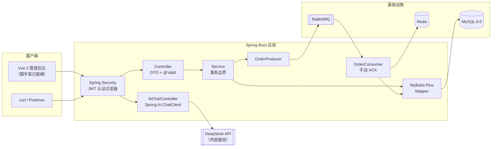
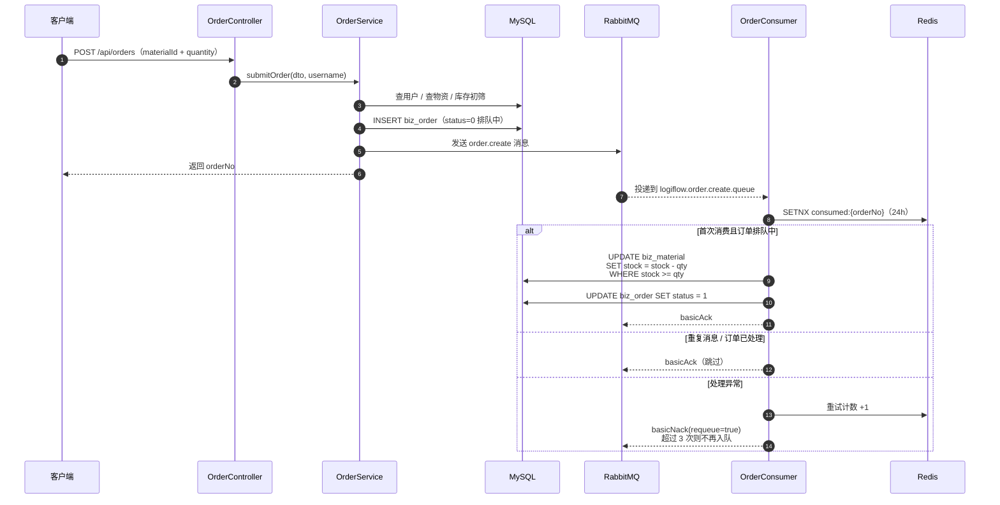
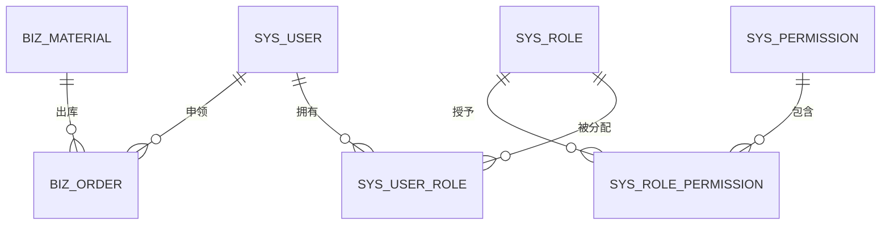
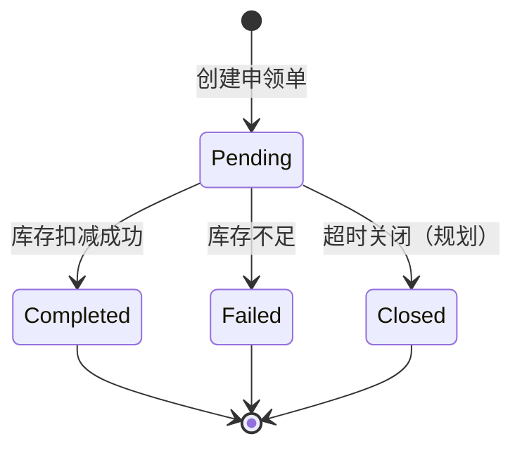

<div align="center">

# LogiFlow

**企业级物资与订单流转系统**

一条「申领下单」链路，串起 JWT 认证、RBAC 权限、乐观锁、Redis 幂等与 RabbitMQ 异步扣库存。


</div>

> 🚧 **开发状态**：后端主体已完成——统一响应与全局异常、JWT + RBAC、物资管理、RabbitMQ 异步下单链路、Spring AI 流式对话、Docker Compose 部署均已落地；Vue 3 + Naive UI 管理后台脚手架（`frontend/`）已就绪，业务页面开发中，详见下方路线图。

---

## ✨ 项目简介

LogiFlow（**Logi**stics + **Flow**）是一个面向企业内部的物资申领与订单流转系统：员工登录后提交物资申领单，系统先在事务内落单，再通过 RabbitMQ 异步扣减库存，并以 **Redis `SETNX` + 订单状态校验 + 数据库唯一索引** 多重幂等，保证消息重复消费也不会重复扣库存。

除了业务本身，这个项目更想完整演示一套「生产级后端」的工程结构：

| 特性 | 实现方式 |
| --- | --- |
| 🔐 无状态认证 | Spring Security + JWT，登录签发 HS256 Token，请求经自定义过滤器校验后写入 `SecurityContext` |
| 🛂 细粒度权限 | RBAC 五表模型，按用户聚合权限标识，支持方法级权限校验（如 `sys:order:add`） |
| 🧱 统一 API 契约 | `Result<T>` + `ResultCode` 枚举 + `@RestControllerAdvice`，前端只需处理一种响应结构 |
| 🛡️ 防超卖 | 库存扣减使用 `stock >= quantity` 的原子条件 UPDATE；物资编辑使用 `@Version` 乐观锁 |
| 🔁 消费幂等 | Redis `SETNX`（24 小时）+ 订单 `status = 0` 校验，再以 `biz_order.uk_order_no` 唯一索引兜底 |
| 📨 可靠投递 | 消费端手动 ACK；失败重试上限 3 次，避免毒消息死循环；生产端发送失败回滚订单事务 |
| 🧹 数据治理 | MyBatis-Plus 全局逻辑删除，查询自动过滤，避免手写 `deleted = 0` |
| 🧩 分层规范 | Controller / Service / DAO 三层，DTO / Entity / VO 严格分离，入参 `@Valid` 校验 |
| 🤖 AI 助手 | Spring AI 2.0 + DeepSeek（OpenAI 兼容协议），`ChatClient` SSE 流式输出 |
| 🐳 一键部署 | 多阶段 Dockerfile + Compose 编排 MySQL / Redis / RabbitMQ / 应用 |

## 🧰 技术栈

| 分类 | 技术 | 用途 |
| --- | --- | --- |
| 语言与运行时 | Java 21 | 主语言，使用文本块等新语法 |
| 应用框架 | Spring Boot 4.1.2 | 自动配置、内嵌 Tomcat 11 |
| Web 层 | Spring WebMVC | RESTful API、参数绑定与校验 |
| 前端 | Vue 3 + TypeScript + Vite 8 + Naive UI | 管理后台（`frontend/`），组件按需自动导入 |
| 安全 | Spring Security + JJWT 0.11.5 | 无状态认证、BCrypt 密码加密、RBAC 鉴权 |
| 持久层 | MyBatis-Plus 3.5.17 + MySQL 8.0 | 单表 CRUD、分页、逻辑删除、乐观锁 |
| 缓存 | Redis（Lettuce 客户端） | 幂等 SETNX、消息重试计数 |
| 消息 | RabbitMQ + Spring AMQP | 异步扣库存；延时关单（规划） |
| AI | Spring AI 2.0.3 + DeepSeek | `ChatClient` 流式对话，经 OpenAI 兼容协议接入 |
| 构建 | Maven Wrapper | 无需预装 Maven，`./mvnw` 开箱即用 |
| 部署 | Docker + Docker Compose | 多阶段构建与一键编排 |

> 💡 **Spring Boot 4 小贴士**：Web starter 已更名为 `spring-boot-starter-webmvc`（3.x 中为 `spring-boot-starter-web`），Servlet 容器为 Tomcat 11；持久层需使用 `mybatis-plus-spring-boot4-starter`，旧的 boot3 starter 在 Boot 4 下不会注册 Mapper。Spring AI 需选 **2.0.x**（对应 Boot 4.1.x），1.1.x 面向 Boot 3.5，在 Boot 4 下会因 Framework 7 的 API 变化启动失败。本文档与代码均按 Boot 4 的依赖习惯编写。

## 🏗️ 系统架构



## 🔁 核心链路：异步下单



要点：

1. **先落单、后扣减**：订单在本地事务中插入（状态 `0`），库存扣减交给 MQ 异步完成，主流程快速返回。
2. **不丢消息**：生产端发送失败会抛异常并回滚订单事务；消费端关闭自动 ACK，业务处理成功后再 `basicAck`。`publisher-confirm-type: correlated` 已配置，确认回调可后续补充。
3. **不重扣库存**：Redis `SETNX` 做第一层幂等，订单状态校验挡住重投，`uk_order_no` 唯一索引做数据库层兜底。
4. **不超卖**：库存扣减采用 `UPDATE ... WHERE stock >= quantity` 原子条件更新；物资编辑则走 `@Version` 乐观锁。
5. **防毒消息死循环**：消费异常时用 Redis 计数，最多重试 3 次；超限后 `basicNack(requeue=false)` 停止重投（死信队列规划中）。
6. **事务一致性**：消费异常时标记事务回滚，避免「部分写库成功 + 消息重投」造成重复扣减。

MQ 拓扑：

| 组件 | 名称 |
| --- | --- |
| Exchange | `logiflow.order.direct`（direct，durable） |
| Queue | `logiflow.order.create.queue`（durable） |
| Routing Key | `order.create` |
| 消息体 | `OrderMessage`（orderNo / userId / materialId / quantity），Jackson JSON 序列化 |

## 🚀 快速开始

### 方式一：Docker Compose（推荐）

前置：安装并启动 Docker Desktop。

```bash
cp .env.example .env   # 首次执行；按需修改 MYSQL_ROOT_PASSWORD、RABBITMQ_*、JWT_SECRET 与 AI_API_KEY
docker compose up --build -d
docker compose logs -f app
```

> AI 相关变量（`AI_API_KEY` / `AI_BASE_URL` / `AI_MODEL`）已通过 `app.environment` 注入应用容器，未设置时回退到 Compose 中的默认值。`AI_API_KEY` 留空不影响其他功能，仅 `/api/ai/**` 调用失败。

启动后：

- 应用：<http://localhost:8080>
- RabbitMQ 管理台：<http://localhost:15673>（账号 / 密码见 `.env`）
- 宿主机 3306 / 6379 / 5672 / 15672 不会被占用，避免与本机 Homebrew 服务冲突

Compose 首次启动会自动执行 `src/main/resources/db/init.sql` 建库建表，数据持久化在 `mysql-data` 卷中。**`init.sql` 不含种子用户**，首次仍需插入测试账号（见下方 SQL）。

进入容器执行 SQL：

```bash
docker compose exec mysql mysql -uroot -p logiflow_db
```

常用命令：

```bash
docker compose ps         # 查看服务与健康状态
docker compose down       # 停止并保留数据卷
docker compose down -v    # 连数据卷一起删除（下次重新执行 init.sql）
```

### 方式二：本地运行

#### 环境要求

| 依赖 | 版本 | 默认连接 |
| --- | --- | --- |
| JDK | 21 | — |
| Maven | 3.9+（或直接用 `./mvnw`） | — |
| MySQL | 8.0 | `localhost:3306` |
| Redis | 6.0+ | `localhost:6379` |
| RabbitMQ | 3.x | `localhost:5672` / 管理台 `15672` |

macOS 下可用 Homebrew 一键安装并启动：

```bash
brew install openjdk@21 mysql redis rabbitmq
brew services start mysql redis rabbitmq
```

#### 1. 准备环境变量

`JWT_SECRET` 为必填项，没有内置默认值，缺失时应用会直接启动失败。先在项目根目录准备 `.env`：

```bash
cp .env.example .env
# 编辑 .env：
#   JWT_SECRET  必填，用 `openssl rand -base64 48` 生成
#   AI_API_KEY  可选，DeepSeek 控制台的 API Key；留空只影响 /api/ai/** 接口
```

`application.yml` 通过 `spring.config.import: optional:file:.env[.properties]` 自动加载项目根目录的 `.env`，本地无需手动 export；生产环境没有 `.env` 时改用系统环境变量注入。

#### 2. 初始化数据库

建库并创建 7 张表（RBAC 五表 + 物资表 + 订单表）：

```bash
mysql -uroot -h127.0.0.1 < src/main/resources/db/init.sql
```

#### 3. 创建本地测试账号

`init.sql` 只负责建表，不包含种子数据。登录前先插入一个测试账号（账号 `admin` / 密码 `123456`）：

```sql
USE logiflow_db;

-- 密码为 123456 的 BCrypt 密文，仅用于本地开发，请勿在生产环境使用
INSERT INTO sys_user (username, password, nickname, status)
VALUES ('admin', '$2y$10$hBFLflrcjFhzHdtvfb5xMuvypW0x.Q8JpHaPcisz/3AyLaOBdZ3iK', '管理员', 1);
```

> 未分配角色和权限时，`UserDetailsServiceImpl` 会回退到一个默认权限标识，方便本地联调；后续可自行插入 `sys_role` / `sys_permission` 等数据体验完整的 RBAC。

#### 4. 配置说明

默认配置位于 `src/main/resources/application.yml`，支持环境变量覆盖：

| 环境变量 | 默认值 | 说明 |
| --- | --- | --- |
| `DB_HOST` / `DB_PORT` | `localhost` / `3306` | MySQL 地址 |
| `DB_USERNAME` / `DB_PASSWORD` | `root` / 空 | 数据库账号（Compose 中由 `.env` 注入） |
| `REDIS_HOST` / `REDIS_PORT` | `localhost` / `6379` | Redis 地址 |
| `RABBITMQ_HOST` / `RABBITMQ_PORT` | `localhost` / `5672` | RabbitMQ 地址 |
| `RABBITMQ_USERNAME` / `RABBITMQ_PASSWORD` | `guest` / `guest` | RabbitMQ 账号 |
| `JWT_SECRET` | **无默认值（必填）** | HS256 密钥，至少 32 字节；缺失时启动失败 |
| `jwt.expiration`（yml 内） | `604800000` | Token 有效期，默认 7 天 |
| `AI_API_KEY` | 空 | DeepSeek API Key；为空时仅 AI 接口调用失败，不影响其他功能 |
| `AI_BASE_URL` | `https://api.deepseek.com/v1` | OpenAI 兼容端点；Spring AI 2.0 的 base-url 需包含 `/v1` |
| `AI_MODEL` | `deepseek-flash` | 对话模型名称 |

以上变量均可写入项目根目录的 `.env`（本地启动自动加载），或通过系统环境变量注入。**密钥类配置不要写进 `application.yml`**，该文件会随代码提交。

#### 5. 启动服务

```bash
./mvnw spring-boot:run
```

服务默认监听 <http://localhost:8080>。首次启动前请确保 MySQL、Redis、RabbitMQ 均已运行，否则 Spring 上下文初始化会因连接失败而退出。

#### 6. 验证登录

```bash
curl -X POST http://localhost:8080/api/auth/login \
  -H "Content-Type: application/json" \
  -d '{"username": "admin", "password": "123456"}'
```

```json
{
  "code": 200,
  "msg": "登录成功",
  "data": {
    "token": "<JWT_TOKEN>",
    "tokenHead": "Bearer "
  }
}
```

后续请求在 `Authorization` 头中携带 Token：

```http
Authorization: Bearer <JWT_TOKEN>
```

#### 7. 启动前端（开发模式）

前端位于 `frontend/`，需要 Node.js 22.18+ 或 24+：

```bash
cd frontend
npm install
npm run dev   # http://localhost:5173，/api 代理到后端 8080
```

#### 常用命令

```bash
./mvnw compile   # 编译
./mvnw test      # 运行测试（需三个中间件在线，且已配置 .env）
./mvnw package   # 打包到 target/logiflow-0.0.1-SNAPSHOT.jar
```

前端常用命令（在 `frontend/` 下执行）：

```bash
npm run dev     # 开发服务器
npm run build   # 类型检查 + 生产构建
npm run lint    # ESLint + oxlint
```

## 📡 接口与响应

### 已实现接口

| 方法 | 路径 | 说明 | 鉴权 |
| --- | --- | --- | --- |
| `POST` | `/api/auth/login` | 账号密码登录，返回 JWT | 白名单 |
| `GET` | `/api/materials/page` | 分页查询物资（`pageNum` / `pageSize` / `keyword` / `category`） | JWT |
| `GET` | `/api/materials/{id}` | 查询物资详情 | JWT |
| `POST` | `/api/materials/add` | 新增物资 | JWT |
| `PUT` | `/api/materials/edit` | 修改物资（乐观锁） | JWT |
| `DELETE` | `/api/materials/{id}` | 逻辑删除物资 | JWT |
| `POST` | `/api/orders` | 提交申领单，异步扣库存 | JWT + `sys:order:add` |
| `GET` | `/api/ai/chat/stream` | SSE 流式 AI 对话（`message` 参数） | JWT |
| `GET` | `/test/hello?name=LogiFlow` | 连通性测试 | 白名单 |
| `GET` | `/test/biz-error` | 业务异常处理演示 | 白名单 |
| `GET` | `/test/sys-error` | 系统异常兜底演示 | 白名单 |

除白名单外的请求均需通过 JWT 认证（见 `SecurityConfig`）；下单接口额外要求 `sys:order:add` 权限。

### 统一响应体

所有接口返回同一种结构，由 `Result<T>` 封装：

```json
{
  "code": 200,
  "msg": "操作成功",
  "data": {}
}
```

| code | 含义 |
| --- | --- |
| `200` | 操作成功 |
| `400` | 参数校验失败 |
| `401` | 未登录或 Token 已过期 |
| `403` | 无相关权限 |
| `500` | 系统内部异常 |
| 自定义 | 业务异常可携带业务码，如 `4001` |

错误统一由 `GlobalExceptionHandler` 捕获：业务异常、`@Valid` 参数校验失败、认证失败、权限不足、系统未知异常各走各的处理分支，不会把堆栈直接暴露给前端。

> 注意：业务异常（如库存不足、物资不存在）返回 **HTTP 200**，业务码在响应体 `code` 中；未登录由 Security 过滤器直接返回 **HTTP 401**。

> 例外：`GET /api/ai/chat/stream` 是 SSE 流式接口，按 `text/event-stream` 直接推送文本片段，不包装为 `Result`。

## 🔐 认证与权限


- 密码使用 **BCrypt** 加盐哈希存储，数据库中不保存明文。
- Token 为无状态 JWT，服务端不保存会话；`sessionCreationPolicy(STATELESS)`。
- 权限标识采用 `sys:order:add` 这类格式，由 RBAC 五表 JOIN 聚合到 `UserDetails`，配合 Spring Method Security 使用；当前下单接口要求调用方具备 `sys:order:add` 权限。
- 未认证与权限不足分别由 `RestAuthenticationEntryPoint` / `RestAccessDeniedHandler` 输出统一的 `Result` 结构。

## 🗄️ 数据库设计



| 表名 | 说明 | 关键设计 |
| --- | --- | --- |
| `sys_user` | 系统用户 | `uk_username` 账号唯一；密码存 BCrypt 密文 |
| `sys_role` | 角色 | `uk_role_code`，如 `ROLE_ADMIN` |
| `sys_permission` | 权限 / 菜单 | `uk_perm_code`；`parent_id` 组成树形菜单 |
| `sys_user_role` | 用户-角色关联 | 联合主键 |
| `sys_role_permission` | 角色-权限关联 | 联合主键 |
| `biz_material` | 物资库存 | `uk_material_code`；`version` 乐观锁保护编辑操作 |
| `biz_order` | 申领订单 | `uk_order_no` 是 MQ 消费幂等的数据库兜底 |

订单状态机：



| 状态值 | 含义 |
| --- | --- |
| `0` | 排队处理中 |
| `1` | 已完成（已扣库存） |
| `2` | 库存不足失败 |
| `3` | 超时关闭 |

## 📁 项目结构

```text
logiflow
├── frontend/            # Vue 3 + TypeScript + Vite + Naive UI 管理后台
│   ├── src/
│   │   ├── router/      # 路由配置
│   │   ├── stores/      # Pinia 状态
│   │   └── views/       # 页面组件
│   └── vite.config.ts   # 开发代理：/api -> localhost:8080
├── src/main/java/com/rickrone/logiflow
│   ├── common
│   │   ├── api          # Result / ResultCode 统一响应契约
│   │   ├── exception    # BusinessException + 全局异常处理
│   │   └── utils        # JwtUtils 签发 / 解析 / 校验
│   ├── config           # SecurityConfig、RabbitMQConfig、MyBatis-Plus 配置
│   ├── controller       # 认证、物资、订单、AI 对话、联调接口
│   ├── mq               # OrderProducer / OrderConsumer / OrderMessage
│   ├── security         # JWT 过滤器、UserDetailsServiceImpl、401/403 处理器
│   ├── service          # 业务接口与实现（物资 / 订单）
│   ├── mapper           # MyBatis-Plus Mapper
│   └── model
│       ├── dto          # Login / Material / Order 入参对象
│       ├── entity       # SysUser / BizMaterial / BizOrder
│       └── vo           # MaterialVO 等出参对象
├── src/main/resources
│   ├── application.yml  # 数据源、Redis、RabbitMQ、JWT、AI 配置（支持环境变量覆盖，自动加载 .env）
│   └── db/init.sql      # 建库 + 7 张表
├── docs/BLUEPRINT.md    # 项目蓝图与实施路线
├── Dockerfile           # 多阶段构建（Maven 构建 + JRE 运行）
├── docker-compose.yml   # MySQL / Redis / RabbitMQ / 应用一键编排
├── .env.example         # 环境变量模板（复制为 .env，已被 gitignore）
├── .dockerignore
├── pom.xml
└── mvnw / mvnw.cmd
```

## 🗺️ 路线图

### ✅ Phase 1 · 工程地基与认证（已完成）

- [x] Spring Boot 4 + MyBatis-Plus 工程骨架
- [x] 统一响应体 `Result<T>` 与错误码枚举 `ResultCode`
- [x] 全局异常处理（业务异常 / 参数校验 / 系统兜底）
- [x] Spring Security 无状态过滤链 + JWT 登录
- [x] BCrypt 密码加密与 RBAC 五表权限模型
- [x] 用户、物资、订单实体与基础 Mapper
- [x] 数据库初始化脚本

### ✅ Phase 2 · 物资与订单（已完成）

- [x] 物资管理：分页查询、新增、编辑、逻辑删除
- [x] DTO / VO 严格分层与 `@Valid` 入参校验
- [x] 申领订单创建接口（同步落单）
- [x] 参数校验与业务异常场景补全

### 🚧 Phase 3 · 异步下单与高可用（基本完成）

- [x] RabbitMQ 交换机 / 队列 / 绑定声明
- [x] 消费者手动 ACK
- [x] Redis `SETNX` + 唯一索引双重幂等
- [x] 原子条件扣库存与失败状态落库
- [x] 消费异常有限重试，避免毒消息死循环
- [ ] 生产者 Confirm 回调完善
- [ ] 死信队列（重试耗尽兜底）
- [ ] 延时队列实现超时关单

### 🚧 Phase 4 · 容器化与前端联调（进行中）

- [x] 后端多阶段构建 Dockerfile
- [x] Docker Compose 编排 MySQL / Redis / RabbitMQ / Backend
- [x] Vue 3 + Naive UI 脚手架（`frontend/`，Vite 代理已配置）
- [ ] Vue 3 管理后台：登录、物资、订单页面
- [ ] Nginx 部署前端静态资源

### 🚧 Phase 5 · AI 助手（进行中）

- [x] 接入 Spring AI 2.0.3（OpenAI 兼容协议）与 DeepSeek
- [x] SSE 流式对话接口 `/api/ai/chat/stream`
- [ ] 对话记忆与多轮会话
- [ ] 基于物资 / 订单数据的工具调用（Function Calling）

## 🤝 贡献

欢迎 Issue 和 Pull Request。提交前请确保：

```bash
./mvnw compile && ./mvnw test
```

建议从 `dev` 分支切出功能分支，提交信息遵循 `feat: / fix: / docs:` 前缀。

## 📄 License

本项目基于 [MIT License](LICENSE) 开源。

---

<div align="center">
  <sub>Built with ☕ and Spring Boot · 如果这个项目对你有帮助，欢迎点一个 ⭐</sub>
</div>
